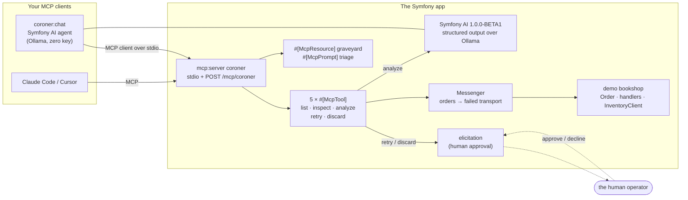

# Coroner

[](https://github.com/EAnge1o/coroner/actions/workflows/ci.yml)


**MCP-powered forensics for Symfony Messenger failed messages.**

Every Symfony app has a graveyard: the failure transport, where messages pile up
after their retries run out. Reading stack traces in there at 2 a.m. is not
forensics — and an AI that just blindly retries everything makes it worse.

Coroner puts the graveyard behind the Model Context Protocol. Point Claude Code,
Cursor, or the bundled Ollama-driven agent at your app, and it will:

1. **list_failed_messages** — walk the graveyard (payloads included, so transient
   and poison messages are tellable apart at a glance),
2. **inspect_failed_message** — open one up: full payload, exception chain, stack
   trace, retry history, the handler's source code,
3. **analyze_failed_message** — run a structured *cause-of-death* diagnosis
   (Symfony AI + Ollama by default, any provider via config): `transient` |
   `bug` | `poison`, root cause, recommended action, concrete fix,
4. **retry_failed_message** — re-queue a message *after the human approves it*,
5. **discard_failed_message** — remove one permanently, *after the human types
   the message id as a typed confirmation*.

The last two are destructive. Coroner never performs them unilaterally: both are
gated by **MCP elicitation**, so the approval happens inside your MCP client —
Claude Code shows a native approval form, our terminal agent asks `[y/n]`.

Built on **Symfony AI 1.0.0-BETA1** and the official **PHP MCP SDK**
(`mcp/sdk` 0.9, via `symfony/mcp-bundle`) — the exact stack the hackathon ships.

## Quick start (5 minutes, no API key)

Requirements: PHP 8.4+, Composer, [Ollama](https://ollama.com) with two models
(`ollama pull qwen2.5:3b` for the chat agent, `ollama pull qwen2.5-coder:7b`
for the pathologist — or see [Docker](#running-ollama-in-docker) below).

```bash
git clone <this repo> coroner && cd coroner
composer install

# Seed the demo app: healthy orders, then an outage, a discontinued SKU and
# poisoned data — the failure transport ends up with one of each class.
php bin/console coroner:demo:break

# Optional: show that the "transient" failures recover when the outage ends
php bin/console coroner:demo:heal
```

### Path A: your own MCP client (Claude Code)

```bash
claude mcp add coroner -- php bin/console mcp:server coroner
```

Then ask:

> *"Something died last night. What failed, why, and what do we do about each one?"*

Claude will list the graveyard, analyze the bodies, and — before touching
anything — pop the native elicitation form to ask *you* to approve a retry or
a discard.

### Path B: the bundled agent (zero external client)

The chat agent is a Symfony AI agent whose toolbox IS the coroner MCP server —
it connects to it as an MCP client over **HTTP** (the sessionless `2026-07-28`
protocol). Two terminals:

```bash
# terminal 1 — the MCP server over HTTP
php -S 127.0.0.1:8033 -t public/

# terminal 2 — the agent
php bin/console coroner:chat
```

Elicitation approvals surface right in the terminal:

```
=============== CORONER APPROVAL REQUIRED ===============
Coroner wants to RETRY failed message #21 (App\Coroner\Message\ProcessOrder). ...
Retry failed message #21 [y/n]:
```

> **Models**: `OLLAMA_MODEL` (the chat agent) **must** be a model whose Ollama
> template emits native tool calls — `qwen2.5:3b` works, and so do
> `llama3.1:8b`, `qwen3:8b`… `qwen2.5-coder:7b` does **not** (its template
> renders tool calls as plain text), but it is the default `OLLAMA_ANALYST_MODEL`
> for the `analyze_failed_message` diagnosis, where it excels.

### Path C: your eyes

```bash
php -S localhost:8000 -t public/
# open http://localhost:8000 — the morgue, live
```

In Claude Code you can also invoke the `coroner_triage` **prompt** (the
canonical investigation workflow) or read the `coroner://graveyard`
**resource** — tools, resources and prompts, the full protocol surface.

`coroner:chat` is a Symfony AI agent whose **toolbox IS the coroner MCP
server** — it connects to it as an MCP client over STDIO (a second `mcp:server`
process, spawned on demand), calls the same tools a foreign client would, and
handles elicitation answers in your terminal:

```
=============== CORONER APPROVAL REQUIRED ===============
Coroner wants to RETRY failed message #21 (App\Coroner\Message\ProcessOrder). ...
Retry failed message #21 [y/n]:
```

> **Windows note:** make sure `php` is on your `PATH` (the bundled agent spawns
> `php bin/console mcp:server coroner` as a subprocess).

## The demo story — three causes of death

`coroner:demo:break` seeds a small bookshop (SQLite, no services) whose Messenger
handlers fail in three distinct, realistic ways:

| Message | Symptom | Diagnosis | Right action |
|---|---|---|---|
| `ProcessOrder` during "inventory API outage" | `InventoryUnavailableException`, dies 3×, reborn in the graveyard | **transient** — the world broke, not the code | wait for the outage (`coroner:demo:heal`), then **retry** |
| `ProcessOrder` for `BOOK-GHOST-000` | `Warning: Undefined array key "count"` → `TypeError` | **bug** — the handler assumes every catalog row has a live stock count | **fix the code, then retry** (see below) |
| `ProcessOrder` with quantity `-2` | `DomainException` on every attempt, forever | **poison** — invalid data; retrying only wastes resources | **discard** (typed id confirmation required) |

The canonical one-line fix for the ghost SKU (used in the demo walkthrough):

```php
// src/Coroner/Service/InventoryClient.php — treat discontinued titles as
// publisher special-orders instead of reading a stock count that isn't there:
$count = $row['stock']['count'] ?? $quantity;
```

Apply it, have Coroner retry the ghost message, and watch it ship. Retry the
*unfixed* one first and it comes back with the same TypeError — which is the
point: **analyze tells you what to fix before you retry.**

## Tools reference

| Tool | Safe? | Notes |
|---|---|---|
| `list_failed_messages(limit)` | read-only | payload digest per message |
| `inspect_failed_message(id)` | read-only | payload, exception, stack trace, handler source |
| `analyze_failed_message(id)` | read-only | one structured Ollama call over the evidence pack |
| `retry_failed_message(id)` | destructive | **elicitation**: boolean approve |
| `discard_failed_message(id)` | destructive | **elicitation**: type the id to confirm |

Retry/discard shell out to `messenger:failed:retry` / `messenger:failed:remove`
with `--force` — the same code path an operator would run, no reimplemented
ack semantics.

## How the human-in-the-loop works

- **STDIO (handshake-era protocol)**: the tool calls
  `$context->getClientGateway()->elicit(...)`; the SDK pauses the tool call and
  sends `elicitation/create` to the client. Claude Code (2.1.76+) renders a
  native approval form; a decline, a cancel, or a wrong typed id all leave the
  message untouched.
- **HTTP (sessionless `2026-07-28` protocol)**: an elicitation ends the request
  and the client re-sends the call with the answer, signed with
  `MCP_REQUEST_STATE_KEY` — see `config/packages/mcp.yaml`.

The HTTP transport is exposed at `POST /mcp/coroner` (localhost-only by
default) if you prefer connecting Claude/other clients over HTTP:
`php -S localhost:8000 -t public/`.

## Architecture



- `src/Coroner/Mcp/CoronerTools.php` — the five tools; services wired straight
  into Messenger's receiver locator and Doctrine.
- `src/Coroner/Mcp/CoronerBriefings.php` — the read-only side: a live
  `coroner://graveyard` resource and the `coroner_triage` workflow prompt.
- `src/Coroner/Mcp/AnalysisService.php` — the pathologist: one structured call
  (native Ollama `format` via the platform's `response_format` option, with a
  tolerant parser as the safety net for other providers).
- `src/Coroner/Mcp/TerminalElicitation.php` — the terminal-side elicitation
  handler (`Mcp\Client\Handler\Request\ElicitationCallbackInterface`).
- `config/packages/ai.yaml` — two agents: `coroner_chat` (tool-using, MCP
  toolbox) and `coroner_analyst` (plain, one-shot).
- `src/Coroner/Controller/DashboardController.php` — `http://localhost:8000/`,
  a live morgue page showing exactly the data the tools operate on.

## Tests

```bash
php bin/phpunit tests/Coroner                # unit: inventory, analysis, tools
php bin/phpunit tests/McpServerIntegrationTest.php   # real STDIO handshake + real graveyard
```

The integration suite speaks JSON-RPC to `mcp:server coroner` exactly like an
MCP client and asserts the graveyard end-to-end.

## Running Ollama in Docker

```bash
docker compose up -d
docker compose exec ollama ollama pull qwen2.5-coder:7b
# .env already points at OLLAMA_ENDPOINT=http://127.0.0.1:11434
```

Any other provider works too — swap the platform in `config/packages/ai.yaml`
(`symfony/ai-anthropic-platform`, `symfony/ai-open-ai-platform`, …) and set the
matching env var; Ollama is only the zero-key default.

## Notes & known limits

- The demo uses `doctrine:schema:update` (run by `coroner:demo:break`) instead
  of migrations — it is a disposable demo database, not a production schema.
- `analyze` runs one LLM call; on CPU-only machines a 7B model takes ~10-30 s.
  Any smaller Ollama model works (`OLLAMA_MODEL` in `.env`).
- elicitation on the sessionless protocol needs `MCP_REQUEST_STATE_KEY` (already
  generated in `.env`); handlers that ask exactly once do not strictly need it,
  but Coroner enables it to support the `2026-07-28` revision cleanly.

## License

MIT — see [LICENSE](LICENSE).
